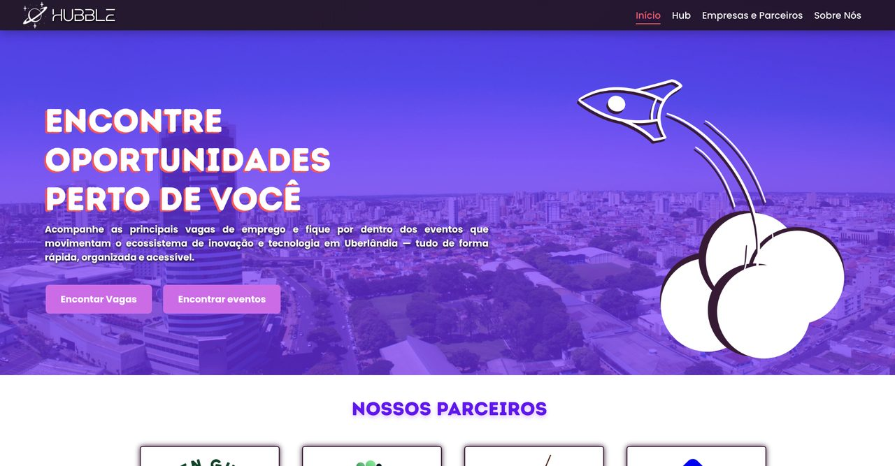
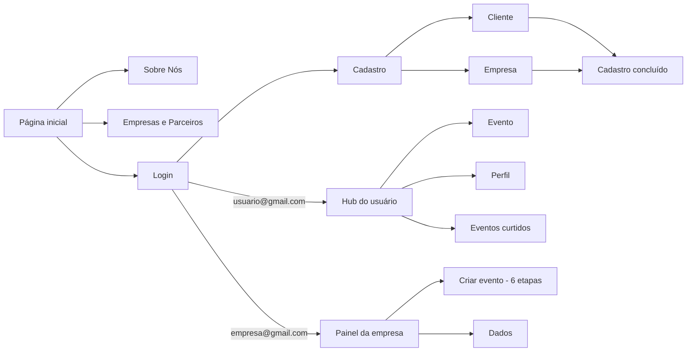
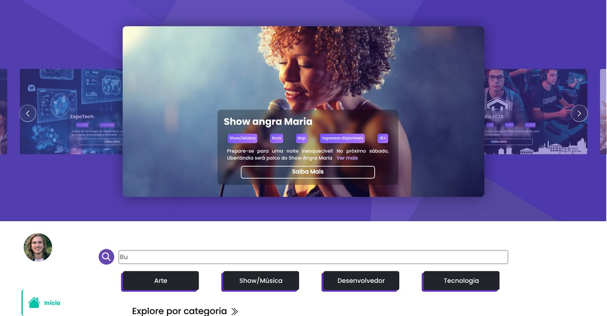
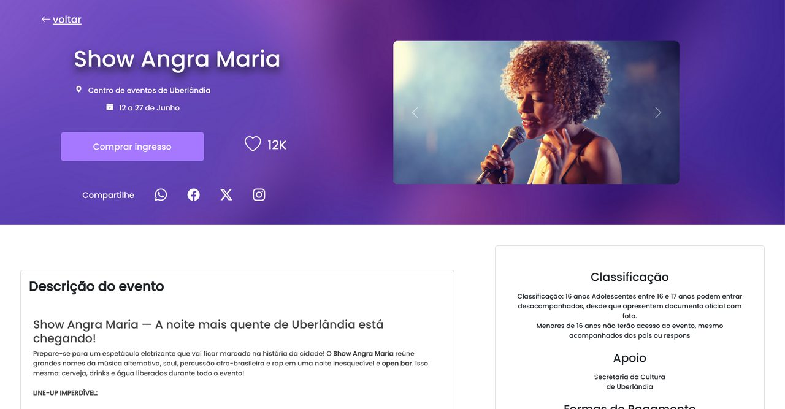
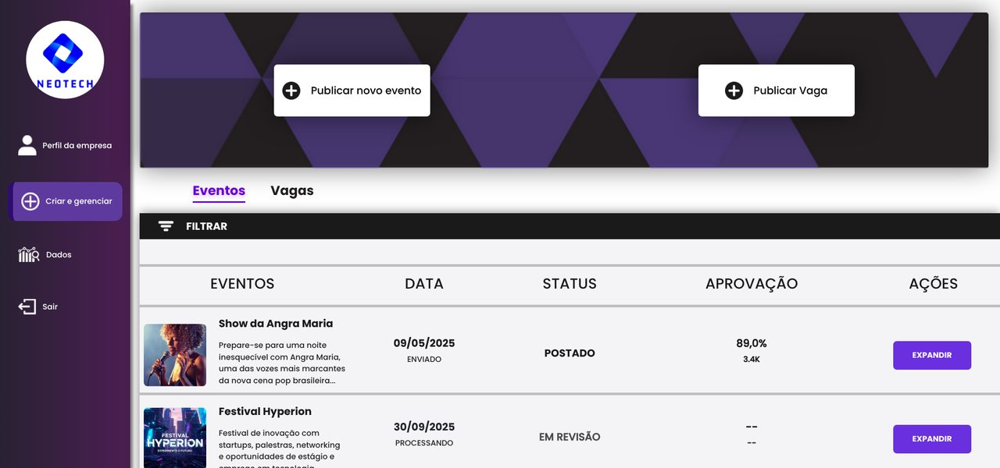
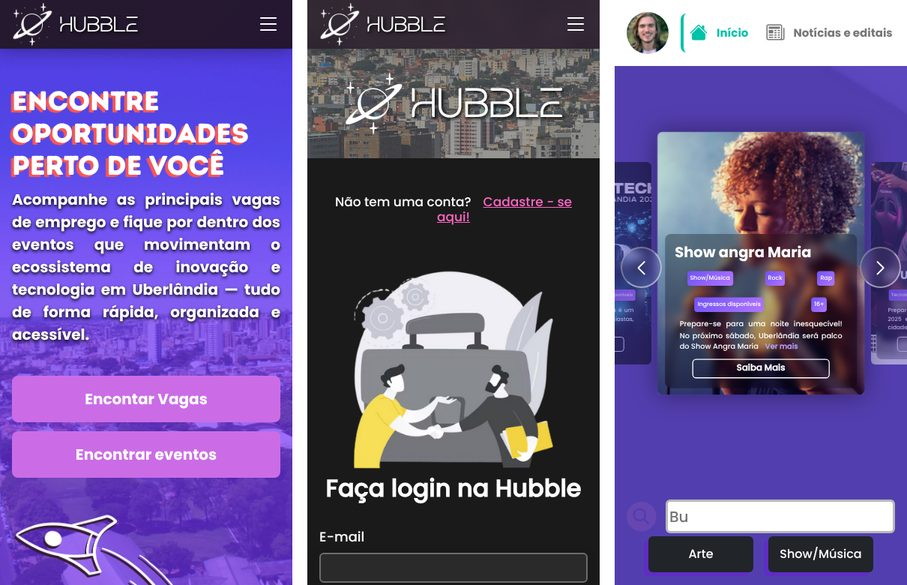

# HUBBLE

> Plataforma que conecta pessoas a eventos, vagas e oportunidades do ecossistema de inovação de Uberlândia.

Trabalho de Conclusão de Curso (TCC) do curso **Técnico em Informática para Internet**.



---

## Sumário

- [Sobre o projeto](#sobre-o-projeto)
- [Funcionalidades](#funcionalidades)
- [Como acessar](#como-acessar)
- [Contas de teste](#contas-de-teste)
- [Navegação entre as páginas](#navegação-entre-as-páginas)
- [Capturas de tela](#capturas-de-tela)
- [Tecnologias](#tecnologias)
- [Estrutura do projeto](#estrutura-do-projeto)
- [Limitações do protótipo](#limitações-do-protótipo)
- [Vídeo pitch](#vídeo-pitch)

---

## Sobre o projeto

A **HUBBLE** é um sistema web desenvolvido como projeto acadêmico com o objetivo de facilitar a organização e a divulgação de eventos corporativos, sociais e festivos em âmbito nacional, com foco inicial no município de **Uberlândia (MG)**.

A plataforma centraliza em um único ambiente informações sobre eventos, contratos, oportunidades de emprego e divulgações, oferecendo praticidade tanto para **organizadores** quanto para **usuários interessados**. O sistema conta com áreas de login, divulgação de eventos, oportunidades de emprego, suporte e comunicação.

## Funcionalidades

**Visitante**
- Página inicial com apresentação da plataforma, parceiros e missão
- Páginas *Sobre Nós* e *Empresas e Parceiros*
- Cadastro como **cliente** ou **empresa**, com validação dos campos (nome, e-mail e força da senha)
- Login

**Usuário (cliente)**
- Hub com carrossel de eventos em destaque, busca, categorias, notícias e vagas recomendadas
- Página de evento com galeria de fotos, botão de curtir, compartilhamento em redes sociais, participantes, oportunidades relacionadas e mapa do local
- Perfil do usuário e lista de eventos curtidos

**Empresa**
- Painel para criar e gerenciar eventos e vagas, com status e aprovação
- Criação de evento em 6 etapas (detalhes, data e local, ingressos, mídias, contato e revisão)
- Página de dados com gráficos de inscritos e participantes

## Como acessar

O protótipo é composto apenas por páginas estáticas (HTML, CSS e JavaScript), então **não precisa de instalação**.

1. Clone o repositório (ou baixe o ZIP pelo botão **Code → Download ZIP**):
   ```bash
   git clone https://github.com/Quickmatt23/HUBBLE.git
   ```
2. Abra o arquivo `Protótipo/index.html` no navegador.

> **Dica:** no VS Code, a extensão **Live Server** abre o site com recarregamento automático (clique com o botão direito em `index.html` → *Open with Live Server*).

É necessário estar **conectado à internet**, pois o Bootstrap, os ícones, o carrossel (Swiper) e os gráficos (Chart.js) são carregados por CDN.

## Contas de teste

O protótipo **não possui backend**: o cadastro percorre todas as etapas, mas não salva a conta. Para entrar nas áreas restritas, use os logins abaixo na página **Hub → Login**:

| Perfil  | E-mail              | Senha      | Abre a página                    |
|---------|---------------------|------------|----------------------------------|
| Usuário | `usuario@gmail.com` | `asdfg456` | Hub do usuário (`Hub.html`)      |
| Empresa | `empresa@gmail.com` | `asdfg123` | Painel da empresa (`Hub_empresa.html`) |

## Navegação entre as páginas



## Capturas de tela

| Hub do usuário | Página de evento |
|---|---|
|  |  |

| Painel da empresa | No celular |
|---|---|
|  |  |

## Tecnologias

| Tecnologia | Uso |
|---|---|
| HTML5 e CSS3 | Estrutura e estilo das páginas |
| JavaScript | Validação dos formulários, login de teste, botão de curtir, animações |
| [Bootstrap 5.3](https://getbootstrap.com/) | Grid, componentes e utilitários |
| [Bootstrap Icons](https://icons.getbootstrap.com/) | Ícones |
| [Swiper 11](https://swiperjs.com/) | Carrosséis de eventos e vagas |
| [Chart.js](https://www.chartjs.org/) | Gráficos do painel da empresa |
| Fontes Poppins, Molgan e Intro Rust | Identidade visual (arquivos em `Protótipo/fontes/`) |

## Estrutura do projeto

```
HUBBLE/
├── Protótipo/
│   ├── index.html                  Página inicial
│   ├── Sobre_nos.html, empresas_e_parceiros.html
│   ├── Login.html, cadastro*.html, completo_cadastro_*.html
│   ├── Hub.html, Evento.html, perfil.html, eventos_curtidos.html   Área do usuário
│   ├── Hub_empresa*.html           Painel da empresa
│   ├── css/
│   │   ├── base.css                Fontes, header e rodapé do site (todas as páginas)
│   │   ├── painel-empresa.css      Barra lateral, abas e tabela do painel da empresa
│   │   ├── vaga-card.css           Componente "card de vaga" (Hub e Evento)
│   │   └── <pagina>.css            Estilos específicos de cada página
│   ├── fontes/
│   └── imagens/
├── Video pitch/                    Vídeo de apresentação do projeto
└── docs/capturas/                  Imagens usadas neste README
```

Em cada página os estilos são carregados nesta ordem: Bootstrap → `css/base.css` → componentes (`painel-empresa.css`, `vaga-card.css`) → CSS da página. Cada arquivo de página termina com uma seção `RESPONSIVO`, com as regras para telas menores (breakpoints do Bootstrap: 576px, 768px, 992px, 1200px e 1400px).

## Limitações do protótipo

Por ser um protótipo de interface, algumas partes são apenas ilustrativas:

- Não há banco de dados nem servidor: contas, eventos e vagas não são salvos.
- O login aceita somente as [contas de teste](#contas-de-teste), verificadas em JavaScript na própria página (o que não é seguro numa versão real).
- Busca, filtros, botões "Ver mais" das vagas e o envio de formulários do painel não executam ações.
- Os dados exibidos (eventos, notícias, vagas, gráficos e participantes) são fictícios.

## Vídeo pitch

O vídeo de apresentação do projeto está em [`Video pitch/202507241340.mp4`](Video%20pitch/202507241340.mp4).
